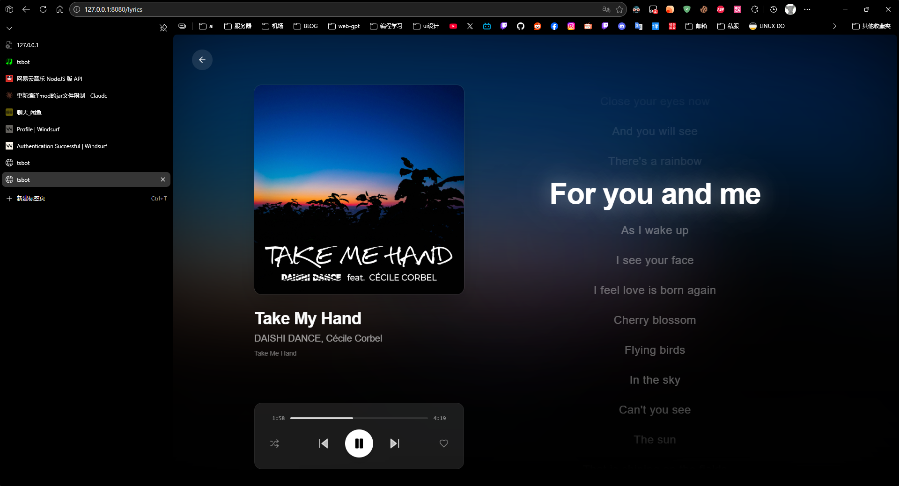
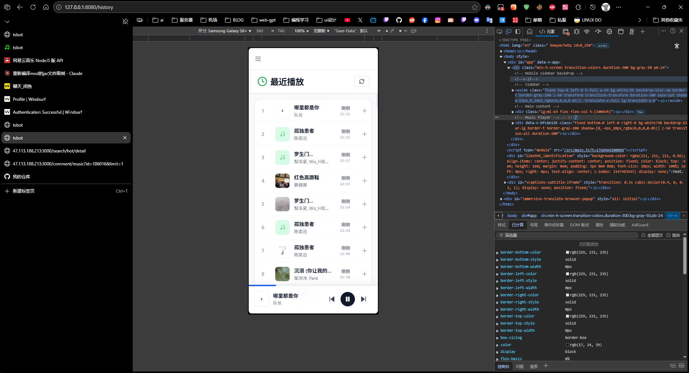
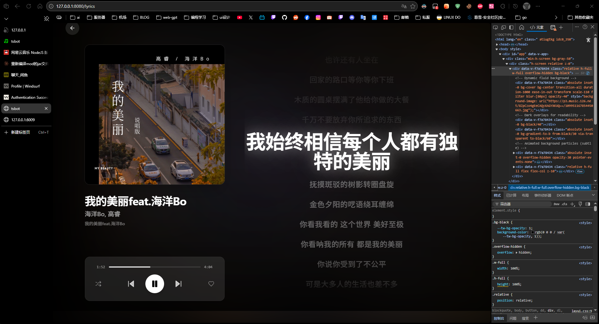
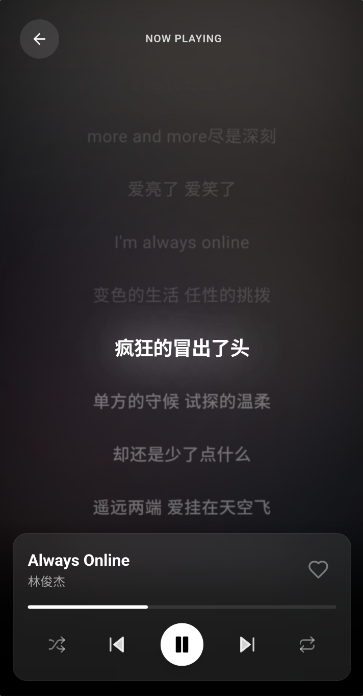
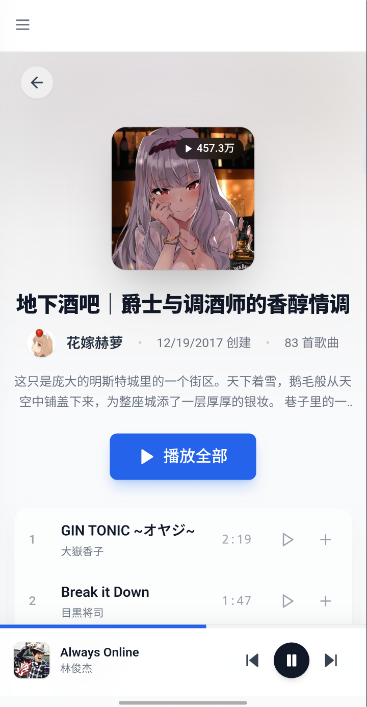

# TSBot · TeamSpeak 3 / 6 Music Bot

[](LICENSE)

[](https://github.com/yichen11818/NeteaseTSBot/releases/latest)
[](CONTRIBUTING.md)
[](README.md)

Listen together in your TeamSpeak channel. Search and queue **Netease Cloud Music, QQ Music, and Bilibili audio** through chat commands or a Web console.

**NeteaseTSBot** supports **TeamSpeak 3 / 6**, with playback queues, lyrics, and prebuilt Docker images for self-hosting.

[Get started](#start-with-prebuilt-docker-images) · [API reference](docs/API.md) · [Contribute](CONTRIBUTING.md) · [Report an issue](https://github.com/yichen11818/NeteaseTSBot/issues/new/choose) · [中文](README.md)

**[Try the live demo →](https://yichen11818.github.io/NeteaseTSBot/)** Explore simulated search, queues, and lyrics without installing anything. The demo does not play real audio. [Demo deployment guide](docs/DEMO.md).



## Start with prebuilt Docker images

You need a Linux host, Docker Compose, and a reachable TeamSpeak 3 / 6 server. Existing installations should keep their environment file, database, and encryption key when upgrading.

```bash
git clone https://github.com/yichen11818/NeteaseTSBot.git
cd NeteaseTSBot
cp tsbot.env.example tsbot.env
```

Replace `TSBOT_COOKIE_KEY` in `tsbot.env` with your own random key (generate one with `openssl rand -hex 32`), then start:

```bash
docker compose -f docker-compose.prebuilt.yml up -d
docker compose -f docker-compose.prebuilt.yml ps
```

1. Open `http://<server-address>:8080`.
2. Read the initial password from `logs/initial-admin-password.txt` on the host, sign in as `admin`, and change the password.
3. Set your TeamSpeak server, channel, and music sources in the Web system settings. Apply the configuration and check that the bot joins your channel.
   First-time administrators enter the setup wizard after changing their password; it saves and applies configuration, then checks Voice, TeamSpeak, and the optional Netease API separately.
4. Search and queue a track in the Web console, or send `help` to the bot in TeamSpeak.

Netease features require your own `NeteaseCloudMusicApi` service. QQ Music and Bilibili adapters are built in. Some features require a platform login; playback depends on account permissions and platform restrictions.

For troubleshooting, run `docker compose -f docker-compose.prebuilt.yml logs --tail=100 backend voice-service`. See [source installation](#quick-start-recommended) and [Docker options](#docker-deployment) for more detail.

## Help build TSBot

Deployment reports, reproducible bug reports, documentation, translations, and code are welcome. See the [contribution guide and starter tasks](CONTRIBUTING.md); you can work on one component at a time. Issues and pull requests in English or Chinese are welcome.

If TSBot helps you, consider starring the repository. To receive release notifications, choose **Watch → Custom → Releases** on GitHub.

## Features

TSBot is a TeamSpeak based music bot; the `voice-service` primary client connection already supports TS6 (historical env var names remain `TSBOT_TS3_*`). It provides:

- **TeamSpeak voice playback** (connects to TeamSpeak servers and plays audio via `voice-service`; primary client connection supports TS3/TS6)
- **Queue and playback control** (pause/resume/next/previous, volume, shuffle/repeat, etc.)
- **Netease music search/playlists/likes/lyrics** (via external `NeteaseCloudMusicApi`)
- **QQ Music search/playlists/lyrics/play URLs** (built into backend; login-required features can be configured from the web console)
- **Bilibili video search and audio playback** (built-in adapter and local audio cache; available subtitles can be displayed on the lyrics page)
- **Web console** (Vue 3 frontend for search/queue/lyrics/settings)
- **External integration API** (`/external/*` for search, queue, status, and playback history; see [API documentation](docs/API.md))

<details>
<summary>More screenshots</summary>






</details>

## Why TSBot (Pain Points and Goals)

This project aims to solve the "dependency hell" and maintainability issues of older setups.

A common old stack looked like this:

- `TS3AudioBot`
- `NeteaseCloudMusicApi`
- `TS3AudioBot-NetEaseCloudmusic-plugin`

In practice, this stack often suffers from:

- **Heavy coupling**: the three pieces are tightly bound by versions, interfaces, and runtime assumptions, making deployment and troubleshooting expensive.
- **Hard API replacement/updates**: Netease-related APIs change frequently, and replacing/upgrading API logic can cascade into bot core or plugin code.
- **Critical plugin disappearance**: if `TS3AudioBot-NetEaseCloudmusic-plugin` becomes unavailable, the whole chain breaks and can no longer be maintained.

TSBot redraws those boundaries:

- **Voice and business logic are decoupled**: `voice-service` only handles "connect to TeamSpeak + play audio", exposing a stable gRPC control surface.
- **Netease is a replaceable dependency**: backend talks to an external `NeteaseCloudMusicApi` service configured in Web system settings; future replacements/upgrades are largely isolated in backend adapters.
- **Maintainable and evolvable architecture**: frontend/backend/voice-service can iterate independently, reducing single-point breakage.

The project has 3 components:

- **backend/**: Python/FastAPI backend (queue/search/Netease + QQ Music integration/voice control)
- **voice-service/**: Rust voice service (TeamSpeak connection + audio playback, exposes gRPC to backend)
- **web/**: Vue 3 + Vite frontend (web console/player UI)

More docs:

- `HOWTOSTART.md` (deployment/run guide)
- `LOGGING.md` (unified logging system)
- `web/README.md` (frontend details)

## System Requirements

- **Linux** (Ubuntu 20.04+ recommended)
- **Python**: 3.8+
- **Node.js**: 16+
- **Rust**: 1.70+ (for `voice-service`)

Music source dependency notes:

- **NeteaseCloudMusicApi** (required only for Netease features; self-hosted HTTP service)
- **QQ Music** (built into backend; user playlists and more stable song URLs usually require an admin QQ Music cookie)

## Architecture Overview

```text
   [web (Vue3)]  <--HTTP-->  [backend (FastAPI)]  <--gRPC-->  [voice-service (Rust)]  -->  TeamSpeak (TS3/TS6)
                                 |
                                 | HTTP
                                 v
                        [NeteaseCloudMusicApi]
```

## TeamSpeak / TS6 Support

- The `voice-service` primary client connection path already supports TeamSpeak login, channel join, text messaging, and audio playback against TS3/TS6 servers.
- Configure TeamSpeak connections in Web system settings. Historical `TSBOT_TS3_*` environment values are imported once when the corresponding database settings do not yet exist.
- The code still contains an optional legacy `ServerQuery` fallback used only for old-style `client_description` updates; it is not the TS6 HTTP(S) Query interface.

## Netease Support (Optional, via `NeteaseCloudMusicApi`)

When automatic track advancement encounters a transient music-source error, queued tracks are retained and recovery is retried after 15, 30, and 60 seconds, at most three times. Recovery runs without blocking chat commands; stop, clear, pause, or a new playback request cancels it. Persistent failures leave the queue available for a later manual retry.

This project does **not** directly call Netease official APIs. Instead, it forwards through your own `NeteaseCloudMusicApi` deployment.

- **NPM**: https://www.npmjs.com/package/NeteaseCloudMusicApi
- **Docs**: https://neteasecloudmusicapi.js.org/#/

After deployment, set the Netease API URL in Web system settings (for example, `http://127.0.0.1:3000/` for a source installation on the same host).

Common deployment options (choose one, exact args follow upstream docs):

```bash
# Option A: start directly with npx
npx NeteaseCloudMusicApi@latest

# Option B: use Docker (common image: binaryify/neteasecloudmusicapi)
# docker run -d --name ncm-api -p 3000:3000 binaryify/neteasecloudmusicapi
```

It is recommended to deploy this service where **backend can reach it** (same host `127.0.0.1:3000` or an internal network address).

## QQ Music Support (Built-in)

QQ Music support is provided directly by the backend; you do not need to deploy a separate QQ Music API service.

- Search, song details, playlists, lyrics, album/artist/MV information are already exposed by backend endpoints.
- Play URLs, user playlists, and other login-required features usually need an admin QQ Music cookie.
- Admins can scan a QR code in the web console, or call `/admin/qqmusic/*` APIs to store/confirm the cookie.

## Quick Start (Recommended)

### 1) Configure Environment Variables

Copy the template and edit:

```bash
cp tsbot.env.example tsbot.env
```

For a new installation, set `TSBOT_COOKIE_KEY` to your own random key. Keep the same key when upgrading so stored credentials remain readable.

The backend generates an initial password for `admin`, writes it to `logs/initial-admin-password.txt`, and requires a password change on first login. Configure TeamSpeak, music sources, platform logins, and external API tokens in the Web system settings, then apply the configuration. Saving settings alone does not apply them to running services.

If you lose the admin password, run this on the server from the project root (using the backend environment created below):

```bash
backend/.venv/bin/python -m backend.admin_cli reset-password
```

The environment file retains startup settings for the database, listening addresses, Web proxy, and development ports. Old `TSBOT_TS3_*` and music-source environment values are imported only when their database settings do not exist. `TSBOT_ADMIN_TOKEN` is a legacy one-time initialization input, not an ongoing admin API credential.

### 2) Install Dependencies

Backend (Python):

```bash
cd backend
python3 -m venv .venv
source .venv/bin/activate
pip install -r requirements.txt
python -m playwright install chromium
cd ..
```

Frontend (Node):

```bash
cd web
npm install
cd ..
```

Voice service (Rust):

```bash
# Install Rust if not installed
# https://rustup.rs/

# Build voice-service
make voice-build
```

You can also use the convenience targets added to the repository:

```bash
make backend-setup
make web-build
make all
```

### 3) Foreground Startup (production-style)

Run in 3 terminals:

```bash
./run-voicemake.sh
```

```bash
./run-backend.sh
```

```bash
./run-web.sh
```

These scripts automatically read root `tsbot.env`. `run-web.sh` now builds the frontend bundle first, then serves it with `vite preview` on `TSBOT_WEB_PORT` (default `8080`).

### 4) One-Command Startup (`nohup`, recommended for remote servers)

```bash
chmod +x ./nohup-start.sh ./nohup-stop.sh ./nohup-status.sh

# Start (launches voice/backend/web and writes logs to logs/)
./nohup-start.sh

# Check status (ports + log paths)
./nohup-status.sh

# Stop
./nohup-stop.sh
```

### 5) Local Development Startup (with reload / dev server)

Run in 3 terminals:

```bash
./run-voicemake.sh
```

```bash
backend/.venv/bin/uvicorn backend.main:app --reload --reload-exclude "backend/_generated/*" --host 127.0.0.1 --port 8009
```

```bash
npm --prefix web run dev
```

Local development uses `http://127.0.0.1:5173` by default and proxies `/api` to the backend.

## Docker Deployment

The repository now includes:

- `docker-compose.yml`
- `docker-compose.prebuilt.yml`
- `Dockerfile.backend`
- `Dockerfile.voice-service`
- `Dockerfile.web`

### 1) Prepare env file

```bash
cp tsbot.env.example tsbot.env
```

If your `NeteaseCloudMusicApi` runs on the host machine, set its URL to `http://host.docker.internal:3000/` in Web system settings after startup.

### 2) Build and run

```bash
docker compose up -d --build
```

### 3) Inspect

```bash
docker compose ps
docker compose logs -f backend
docker compose logs -f web
```

### 4) Stop

```bash
docker compose down
```

Compose starts 3 services by default:

- `voice-service` (`50051`)
- `backend` (`8009`)
- `web` (`8080`, Nginx serves the production frontend bundle and reverse-proxies `/api/*` to backend)

### 5) Use published images directly (Docker Hub / GHCR)

If you do not want to build locally, you can consume the prebuilt images published by GitHub Actions. The repository also ships `docker-compose.prebuilt.yml`, which pulls the official Docker Hub images by default:

```bash
# Docker Hub (default latest)
docker compose -f docker-compose.prebuilt.yml up -d

# Pin a release tag, for example v0.4.0
TSBOT_IMAGE_TAG=v0.4.0 docker compose -f docker-compose.prebuilt.yml up -d

# Switch to GHCR
TSBOT_IMAGE_REGISTRY=ghcr.io \
TSBOT_IMAGE_NAMESPACE=yichen11818 \
docker compose -f docker-compose.prebuilt.yml up -d
```

Image naming format (the Docker Hub namespace is `yumi118`; the current GitHub Packages / GHCR owner is `yichen11818`; forks can override via env vars):

- `docker.io/<namespace>/neteasetsbot-backend:<tag>`
- `docker.io/<namespace>/neteasetsbot-web:<tag>`
- `docker.io/<namespace>/neteasetsbot-voice-service:<tag>`
- `ghcr.io/<owner>/neteasetsbot-backend:<tag>`
- `ghcr.io/<owner>/neteasetsbot-web:<tag>`
- `ghcr.io/<owner>/neteasetsbot-voice-service:<tag>`

Notes:

- GitHub **Packages** only shows GHCR packages, so it stays empty if you only push to Docker Hub.
- Seeing **3 image repositories** is expected because the project publishes `backend`, `web`, and `voice-service` separately.
- GitHub **Releases** also includes `tsbot-<version>-linux-amd64.tar.gz` and `SHA256SUMS.txt`; those are downloadable bundles, not container images.

## Default Ports

- **voice-service gRPC**: `127.0.0.1:50051`
- **backend**: `127.0.0.1:8009` (`TSBOT_PORT`)
- **web (production / Docker / run-web.sh)**: `127.0.0.1:8080` (`TSBOT_WEB_PORT`)
- **web (local dev server)**: `127.0.0.1:5173` (`VITE_DEV_PORT`)

Backend OpenAPI docs:

- `http://127.0.0.1:8009/docs`

## Platform Login State (Netease / QQ Music / Bilibili)

Use **System settings → Music membership login** to manage platform logins. Cookies are encrypted in the database. The old `/cookie` page redirects to this settings section.

### Bilibili

The built-in adapter supports video search and audio playback, with local audio caching. Administrator login is available through QR code or manual cookie entry. For subtitle fallback on videos with AI subtitles, the backend may use Playwright with the stored Bilibili login. Source installations need `python -m playwright install chromium`; the provided backend Docker image installs Chromium and its system dependencies during the image build.


### Netease Cookie

Backend encrypts and stores the "admin Netease cookie" in database (`tsbot.db`) for:

- getting more stable song URLs (avoid anonymous restrictions on some endpoints)
- accessing features requiring login state (playlists, likes, etc.)

The Web console handles administrator authentication through `/auth/login`. Direct API clients must retain the admin session and include the session CSRF token on state-changing requests. Admin APIs include:

- `POST /admin/cookie`: store cookie
- `GET /admin/status`: check if cookie exists
- `GET /admin/account`: verify cookie validity

The frontend also provides a setup UI (see `web/README.md`).

### QQ Music Cookie

Backend also encrypts and stores the "admin QQ Music cookie" in database (`tsbot.db`) for:

- getting more stable QQ Music play URLs
- accessing login-required features such as user playlists and account info

The Web console handles administrator authentication through `/auth/login`. Direct API clients must retain the admin session and include the session CSRF token on state-changing requests. Admin APIs include:

- `GET /admin/qqmusic/status`: check if cookie exists
- `POST /admin/qqmusic/cookie`: store cookie manually
- `POST /admin/qqmusic/qr/confirm`: confirm QR login from the web UI and persist the cookie

The web console includes a QQ Music QR login flow.

## Logging

Logs are written to `logs/` by default:

- `logs/backend.log`
- `logs/voice.log`
- `logs/web.log`

See `LOGGING.md` for details (`scripts/log-viewer.sh` / `scripts/unified-logger.sh`).

## Project Structure

```text
.
├── backend/         # FastAPI backend
├── web/             # Vue3 frontend
├── voice-service/   # Rust voice service (gRPC + TeamSpeak)
├── proto/           # gRPC proto definitions
├── data/            # runtime data/config (e.g. config.json)
├── logs/            # runtime logs (created by startup scripts)
├── HOWTOSTART.md
├── LOGGING.md
└── tsbot.env.example
```

## FAQ

- **Is the web port 5173 or 8080?**
  - `5173` is the local Vite dev server (`npm --prefix web run dev` / `VITE_DEV_PORT`)
  - `8080` is the production foreground and Docker default (`run-web.sh` / `nohup-start.sh` / `TSBOT_WEB_PORT`)

- **Frontend request errors / cannot reach backend?**
  - Recommended default is `VITE_API_BASE=/api`, which is reverse-proxied by dev server / preview / Docker Nginx to backend
  - If you do not use same-origin proxying, set `VITE_API_BASE` explicitly or point `TSBOT_WEB_API_PROXY_TARGET` at the backend

- **Seeing a Vite host security error when accessing via domain?**
  - That is Vite host validation working as designed.
  - Set `TSBOT_WEB_ALLOWED_HOSTS="dev.example.com,.example.com"` in `tsbot.env` and only whitelist the domains you really need.

- **Backend cannot reach voice-service?**
  - Check `TSBOT_VOICE_GRPC_ADDR` is `127.0.0.1:50051`
  - Ensure `make voice-run` or `run-voicemake.sh` is running

- **Is TS6 fully supported?**
  - The primary client connection supports TS6. Configure it in Web system settings; historical `TSBOT_TS3_*` environment values are imported once for migration.
  - Legacy `TSBOT_TS3_SERVERQUERY_*` settings still map to the old ServerQuery fallback, not TS6 HTTP(S) Query.

## License

See `LICENSE`.
