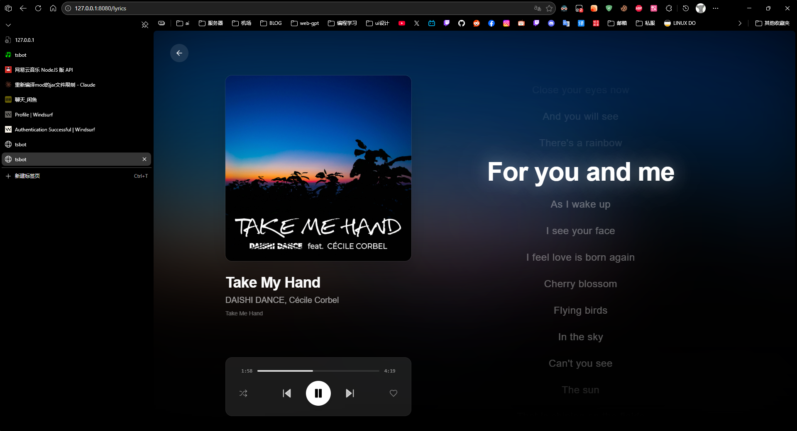
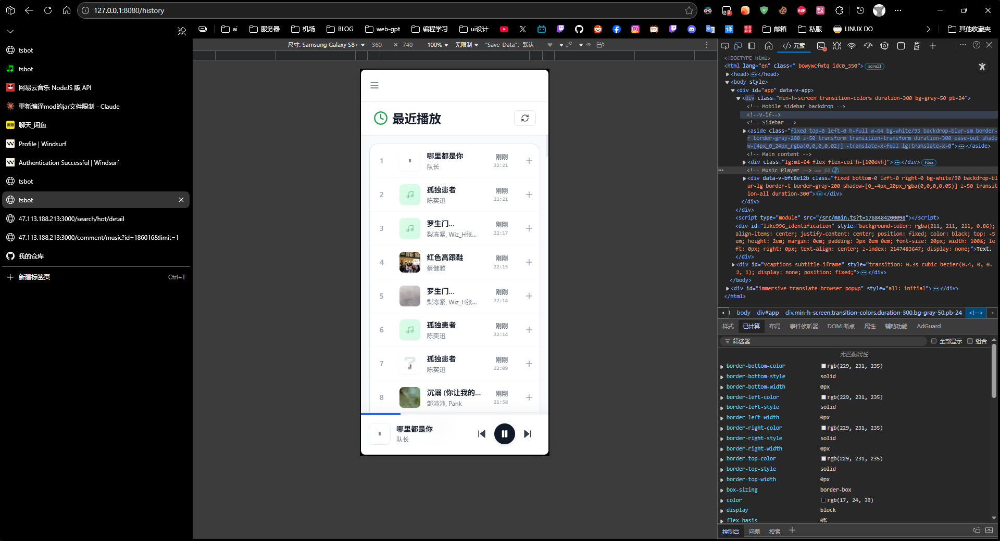
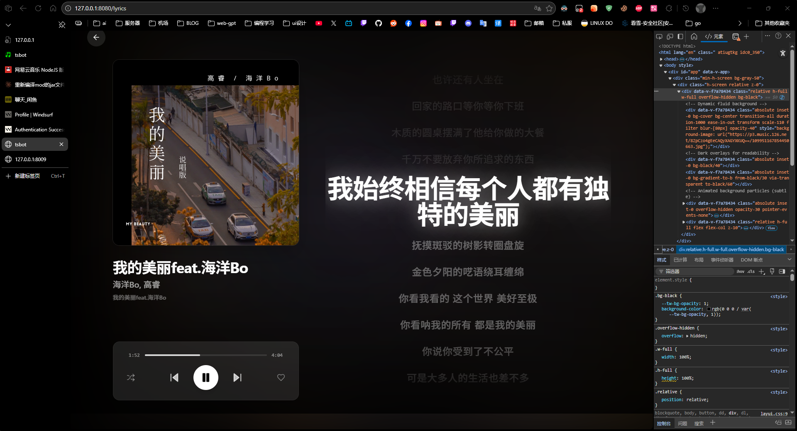
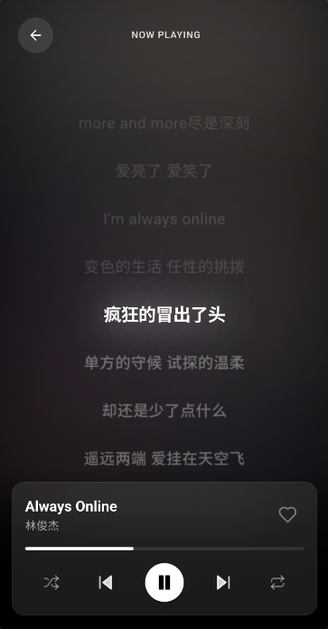
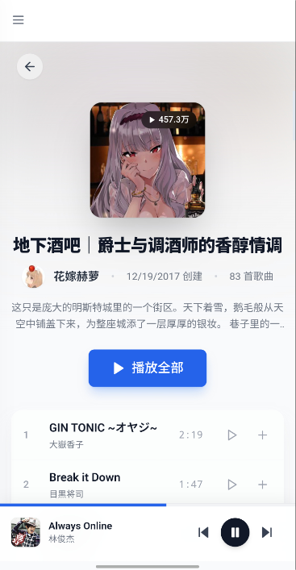

# TSBot · TeamSpeak 3 / 6 音乐机器人

[](LICENSE)

[](https://github.com/yichen11818/NeteaseTSBot/releases/latest)
[](CONTRIBUTING.md)
[](README.en.md)

在 TeamSpeak 频道里和朋友一起听歌：通过聊天指令或 Web 控制台点播 **网易云音乐、QQ 音乐和 Bilibili 音频**。

**NeteaseTSBot** 支持 **TeamSpeak 3 / 6**，提供播放队列、歌词和 Docker 预构建镜像，可自行部署。

[快速部署](#先把机器人跑起来) · [聊天指令](#teamspeak-聊天指令) · [API 文档](docs/API.md) · [参与贡献](CONTRIBUTING.md) · [反馈问题](https://github.com/yichen11818/NeteaseTSBot/issues/new/choose)

**[在线体验 →](https://yichen11818.github.io/NeteaseTSBot/)** 无需安装即可体验模拟搜索、队列和歌词；不播放真实音频。[演示部署说明](docs/DEMO.md)



## 先把机器人跑起来

需要一台 Linux 主机、Docker Compose 和可连接的 TeamSpeak 3 / 6 服务器。已有部署升级请保留原来的 `tsbot.env`、数据库和加密密钥。

```bash
git clone https://github.com/yichen11818/NeteaseTSBot.git
cd NeteaseTSBot
cp tsbot.env.example tsbot.env
```

在 `tsbot.env` 中把 `TSBOT_COOKIE_KEY` 改为自己的随机密钥（可用 `openssl rand -hex 32` 生成），然后使用预构建镜像启动：

```bash
docker compose -f docker-compose.prebuilt.yml up -d
docker compose -f docker-compose.prebuilt.yml ps
```

1. 打开 `http://<服务器地址>:8080`。
2. 在服务器的 `logs/initial-admin-password.txt` 读取初始密码，以 `admin` 登录并修改密码。
3. 在“系统配置”填写 TeamSpeak 地址、频道和音乐源配置，点击“应用配置”，确认机器人进入频道。
   首次登录改密后进入设置，按“TeamSpeak 连接”“音乐账号登录”等分类完成配置；每类均附用途说明。
4. 在 Web 搜索并加入一首歌曲，或在 TeamSpeak 发送 `帮助` 查看聊天指令。

网易云功能需要自行部署 `NeteaseCloudMusicApi`；QQ 音乐和 B 站适配已内建。部分播放和账号功能需要对应平台登录态，实际可播放内容受账号权限及平台限制影响。

遇到问题先查看 `docker compose -f docker-compose.prebuilt.yml logs --tail=100 backend voice-service`。更多选项见 [源码安装](#快速开始推荐)、[Docker 部署](#docker-部署) 和 [运行指南](HOWTOSTART.md)。

## 一起完善 TSBot

欢迎贡献部署经验、问题复现、文档、翻译和代码。第一次参与可以从 [贡献指南中的小任务](CONTRIBUTING.md#适合第一次贡献的任务--starter-tasks) 开始，无需先弄懂 Python、Vue 和 Rust 全部模块。

如果 TSBot 帮到了你，欢迎 Star；想收到新版本通知，可使用 GitHub **Watch → Custom → Releases**。

## 功能一览

TSBot 是一个基于 TeamSpeak 的音乐机器人；`voice-service` 主客户端连接已支持 TS6（历史环境变量名仍保留 `TSBOT_TS3_*`），提供：

- **TeamSpeak 语音播放**（通过 `voice-service` 连接 TeamSpeak 服务器并播放音频；主客户端连接支持 TS3/TS6）
- **播放队列/控制**（暂停/继续/下一首/上一首、音量、随机/循环等）
- **网易云音乐搜索/歌单/喜欢/歌词**（通过外部 `NeteaseCloudMusicApi` 服务）
- **QQ 音乐搜索/歌单/歌词/播放链接**（后端内建适配，登录态能力可通过 Web 控制台配置）
- **B 站视频搜索与音频播放**（支持搜索视频、展示简介/点赞/收藏/投币，并在播放时缓存音频；有字幕的视频可在歌词页显示字幕时间轴，支持通过管理员登录态补抓 AI 字幕）
- **Web 控制台**（Vue3 前端，用于搜索/队列/最近播放/本地收藏/歌词，以及受管理员密码保护的完整运行配置）
- **外部集成 API**（`/external/*` 提供统一搜索、入队、状态读取、历史读取与历史重播）

<details>
<summary>查看更多界面截图</summary>






</details>


## Why TSBot（痛点与目标）

这个项目主要是为了解决旧方案带来的“依赖地狱”和不可维护性。

原有常见组合：

- `TS3AudioBot`
- `NeteaseCloudMusicApi`
- `TS3AudioBot-NetEaseCloudmusic-plugin`

在实践中会遇到：

- **依赖耦合严重**：三者版本/接口/运行方式强绑定，部署和排障成本高。
- **API 难以更新替换**：网易云相关接口经常变化，想替换/升级 API 实现时，改动面会蔓延到 bot 主体或插件。
- **关键插件项目丢失**：`TS3AudioBot-NetEaseCloudmusic-plugin` 在项目完全丢失/不可获取的情况下，整条链路直接断掉，无法继续维护。

TSBot 的目标是把边界重新划清：

- **语音与业务解耦**：`voice-service` 只负责“连接 TeamSpeak + 播放音频”，通过 gRPC 暴露稳定控制接口。
- **网易云作为可替换依赖**：后端通过 `TSBOT_NETEASE_API_BASE` 对接外部 `NeteaseCloudMusicApi`，未来即使要替换/升级，也主要收敛在后端适配层。
- **可维护/可演进**：前端/后端/语音服务三模块独立迭代，减少“一个组件挂了全挂”的情况。

项目由 3 个组件组成：

- **backend/**: Python/FastAPI 后端（队列/搜索/网易云与 QQ 音乐接口/控制语音服务）
- **voice-service/**: Rust 语音服务（连接 TeamSpeak、播放音频，提供 gRPC 给后端调用）
- **web/**: Vue3 + Vite 前端（Web 控制台/播放器 UI）

更多文档：

- `HOWTOSTART.md`（部署/运行指南）
- `LOGGING.md`（统一日志系统）
- `docs/API.md`（后端 API 详细文档）
- `web/README.md`（前端详细说明）

## 系统要求

- **Linux**（推荐 Ubuntu 20.04+）
- **Python**: 3.8+
- **Node.js**: 16+
- **Rust**: 1.70+（用于 `voice-service`）

音乐源依赖说明：

- **NeteaseCloudMusicApi**（仅网易云能力需要；需单独部署 HTTP 服务）
- **QQ 音乐**（后端内建适配；用户歌单和更稳定的播放链接通常需要管理员 QQ 音乐 Cookie）
- **Playwright Chromium**（仅 B 站扫码登录和登录态 AI 字幕抓取需要；安装 Python 依赖后执行 `python -m playwright install chromium`）

## 架构概览

```text
   [web (Vue3)]  <--HTTP-->  [backend (FastAPI)]  <--gRPC-->  [voice-service (Rust)]  -->  TeamSpeak (TS3/TS6)
                                 |
                                 | HTTP
                                 v
                        [NeteaseCloudMusicApi]
```

## TeamSpeak / TS6 支持

- `voice-service` 的主客户端连接路径已经适配 TeamSpeak 服务器登录、进频道、收发文字消息和音频播放，当前可用于 TS3/TS6 服务器。
- TeamSpeak / TS6 连接信息在 Web 控制台的“系统配置”中维护；升级时仍会一次性导入旧的 `TSBOT_TS3_*` 环境变量。
- 代码中仍保留一条可选的 legacy `ServerQuery` fallback，仅用于旧式 `client_description` 更新；它不是 TS6 的 HTTP(S) Query 接口。
- 如果你希望 bot 直接以“模拟客户端”的方式更新自己的简介，可在系统配置中开启“允许直接更新客户端简介”。

### TeamSpeak 聊天指令

指令可以使用中文或英文，并可选择添加 `!` 前缀。以下播放列表指令根据 [PR #10](https://github.com/yichen11818/NeteaseTSBot/pull/10) 的提案重新实现并补充了隔离、过期和队列状态测试，感谢 @yume2017cn 的贡献。

| 中文指令 | 英文指令 | 行为 |
| --- | --- | --- |
| `歌单 <关键词>` | `playlist <keywords>` | 仅检索网易云歌单，显示前 5 个结果；结果按当前 TeamSpeak 用户隔离并保留 5 分钟。 |
| `选择 <编号>` | `select <number>` | 从当前用户最近一次歌单搜索结果中选择歌单，将可用曲目加入播放队列；空闲时自动开始播放。 |
| `清空` | `clear` | 清空播放队列、停止当前播放、取消正在加载的曲目并重置随机队列。 |
| `随机` / `随机播放` | `random` / `shuffle` | 切换为随机播放；空闲时立即从当前队列随机选择曲目。 |
| `顺序` / `顺序播放` | `order` | 切换回队列顺序播放。 |
| `播放` | `play` | 无参数时立即播放队列中的第一首歌曲。 |
| `播放 <ID或关键词>` | `play <ID or keywords>` | 检索并立即播放指定网易云歌曲。 |

可发送 `帮助`、`菜单`、`指令`、`help` 或 `?` 查看机器人返回的完整指令帮助。

## 网易云音乐支持（可选，依赖 `NeteaseCloudMusicApi`）

本项目 **不直接** 调用网易云官方接口；而是通过你自行部署的 `NeteaseCloudMusicApi` 服务转发/封装。

- **NPM**: https://www.npmjs.com/package/NeteaseCloudMusicApi
- **文档**: https://neteasecloudmusicapi.js.org/#/

部署完成后，在 Web 控制台的“音乐接口配置”中填写服务地址（例如 `http://127.0.0.1:3000/`）。

常见部署方式（任选其一，具体参数以官方文档为准）：

```bash
# 方式 A：使用 npx 直接启动
npx NeteaseCloudMusicApi@latest

# 方式 B：使用 Docker（常见镜像：binaryify/neteasecloudmusicapi）
# docker run -d --name ncm-api -p 3000:3000 binaryify/neteasecloudmusicapi
```

建议把该服务部署在 **backend 可访问** 的位置（同机 `127.0.0.1:3000` 或内网地址）。

## QQ 音乐支持（内建）

QQ 音乐能力由后端直接提供，不需要额外部署独立的 QQ 音乐 API 服务。

- 已提供搜索、歌曲详情、歌单详情、歌词、专辑/歌手/MV 信息等接口。
- 播放链接、用户歌单等依赖登录态的能力，通常需要管理员 QQ 音乐 Cookie。
- 管理员可以通过 Web 控制台扫码登录，或调用 `/admin/qqmusic/*` 接口写入/确认 Cookie。

## B 站支持（内建）

B 站能力由后端直接适配，不需要额外部署独立 API 服务。

- 支持搜索 B 站视频，并返回统一后的标题、UP 主、分区、简介、点赞、收藏、投币、封面和原视频链接。
- 支持按 `BV` / `av` / 视频 URL 入队。
- 实际播放时，后端会先把音频下载到本地缓存，再交给 `voice-service` 播放。
- 可通过 Web 控制台或 `/admin/bilibili/*` 接口保存管理员 B 站 Cookie，用于登录态 API 和 Playwright 抓取 AI 字幕。
- 当公开视频接口拿不到字幕轨时，后端会在存在管理员 B 站 Cookie 的前提下，尝试使用登录态接口和 Playwright 页面环境补抓 AI 字幕。
- 可在 Web 控制台限制允许点播的最长视频时长，避免超长视频拖垮播放链路。
- 音频缓存默认保留 72 小时且上限为 2 GiB，可在“音乐接口配置”中调整。

## 快速开始（推荐）

### 0) 使用 Codex 一键安装（可选）

如果你正在使用 OpenAI Codex，可以在一个空目录或目标部署目录中直接让 Codex 代劳克隆、安装依赖、构建并启动项目。

在 Codex 中粘贴下面这段提示词即可：

```text
请帮我一键安装并启动 TSBot：

1. 如果当前目录还没有项目代码，请执行：
   git clone ssh://git@ssh.github.com:443/yichen11818/NeteaseTSBot.git tsbot
   cd tsbot
   如果 SSH 拉取失败，请改用：
   git clone https://github.com/yichen11818/NeteaseTSBot.git tsbot
2. 检查 Linux 环境是否具备 python3、pip、venv、node/npm、rust/cargo、cmake、build-essential、ffmpeg。
3. 在项目根目录执行 chmod +x setup.sh run-*.sh nohup-*.sh。
4. 执行 ./setup.sh 安装后端、前端和 voice-service 依赖并完成构建。
5. 如果 tsbot.env 不存在，请从 tsbot.env.example 复制；如果已存在，不要覆盖。
6. 提醒我只填写 tsbot.env 中的 TSBOT_COOKIE_KEY，并执行 ./nohup-start.sh 启动服务。
7. 从后端日志或 logs/initial-admin-password.txt 读取一次性管理员密码，登录 Web 控制台并修改密码。
8. 在 Web 系统配置中填写 TeamSpeak、音乐源等运行配置，上传界面图标和机器人头像，点击“应用配置”并确认 Voice 重启成功。
9. 最后告诉我 Web 控制台地址、后端 OpenAPI 地址和日志文件位置。
```

如果你已经手动克隆到了本仓库目录，也可以把第 1 步改成“使用当前目录，不要重新 clone”。Codex 执行到需要填写 `tsbot.env` 时应暂停并让你补齐配置；不要把真实 Cookie、token 或服务器密码直接发给 Codex，建议在本机编辑器里修改 `tsbot.env`。

### 1) 配置环境变量

复制模板并修改：

```bash
cp tsbot.env.example tsbot.env
```

新部署只需在环境文件中确认数据库、监听地址，并设置 `TSBOT_COOKIE_KEY`。TeamSpeak、网易云 API、缓存限制、日志、外部 API Token 和平台登录态都在 Web 控制台配置。

首次启动时，后端会为 `admin` 生成随机初始密码，并同时打印到后端日志、写入 `logs/initial-admin-password.txt`。第一次登录必须修改密码；改密成功后该文件会自动删除。忘记密码时可在服务器本地执行：

```bash
.venv/bin/python -m backend.admin_cli reset-password
```

设置页右上角的“保存配置”只把当前表单持久化到数据库，适合先分组检查配置；“应用配置”会合并所有已保存但尚未应用的改动，并更新运行中的服务。TeamSpeak 或 Voice 配置发生变化时，voice-service 会正常断开并自动使用新配置重启；Web 会等待新进程返回对应的配置版本后显示“已重启成功”，不需要给后端 Docker Socket 或 systemd 管理权限。

“TeamSpeak 配置”同时包含连接、频道、身份和客户端简介；“Voice 服务”同时包含后端到 Voice 的连接与 Voice 运行参数，避免同一功能分散在重复菜单中。

界面图标和 TeamSpeak 机器人头像不再接受服务器文件路径。管理员可直接在 Web 设置页上传、更换或清除图片；文件固定保存在 SQLite 数据库所在目录的 `uploads/` 子目录中（Docker Compose 默认是 `data/uploads/`）。头像更换或清除后也会触发 voice-service 自动重启。

网易云用户登录、网易云后台播放授权、QQ 音乐后台授权和 B 站后台授权统一位于“系统配置 → 音乐会员登录”。旧的 `/cookie` 地址会自动跳转到该设置分类。

环境文件中仍可按需配置 `TSBOT_WEB_HOST` / `TSBOT_WEB_PORT`、Web 反向代理目标、允许访问的域名和开发服务器端口。这些参数决定进程如何启动，因此在系统配置中只读展示；其余运行配置都由数据库和 Web 控制台托管。

### 2) 安装依赖

后端（Python）：

```bash
cd backend
python3 -m venv .venv
source .venv/bin/activate
pip install -r requirements.txt
python -m playwright install chromium
cd ..
```

前端（Node）：

```bash
cd web
npm install
cd ..
```

语音服务（Rust）：

```bash
# 安装 Rust（如未安装）
# https://rustup.rs/

# 构建 voice-service
make voice-build
```

也可以直接使用仓库里补好的常用构建目标：

```bash
make backend-setup
make web-build
make all
```

### 3) 前台启动（生产方式）

开 3 个终端分别运行：

```bash
./run-voicemake.sh
```

```bash
./run-backend.sh
```

```bash
./run-web.sh
```

以上脚本会自动读取项目根目录下的 `tsbot.env`。其中 `run-web.sh` 会先构建前端产物，再以 preview 方式监听 `TSBOT_WEB_PORT`（默认 `8080`）。

### 4) 一键启动（nohup，远程部署推荐）

```bash
chmod +x ./nohup-start.sh ./nohup-stop.sh ./nohup-status.sh

# 启动（会分别启动 voice/backend/web，并写日志到 logs/）
./nohup-start.sh

# 查看状态（端口 + 日志路径）
./nohup-status.sh

# 停止
./nohup-stop.sh
```

### 5) 本地开发启动（带 reload / dev server）

开 3 个终端分别运行：

```bash
./run-voicemake.sh
```

```bash
backend/.venv/bin/uvicorn backend.main:app --reload --reload-exclude "backend/_generated/*" --host 127.0.0.1 --port 8009
```

```bash
npm --prefix web run dev
```

本地开发默认访问 `http://127.0.0.1:5173`，并通过 `/api` 代理到后端。

## Docker 部署

### 1) 准备环境变量

```bash
cp tsbot.env.example tsbot.env
```

至少确认 `TSBOT_COOKIE_KEY`。如果 NeteaseCloudMusicApi 运行在宿主机，容器启动后可在 Web 控制台将网易云 API 地址设为 `http://host.docker.internal:3000/`。

### 2) 构建并启动

```bash
docker compose up -d --build
```

当前仓库内置的 `backend` 镜像会在构建阶段自动安装 Playwright Chromium 及其系统依赖，因此正常情况下不需要再手动 `docker exec` 进入容器执行 `python -m playwright install chromium`。如果你更新了仓库里的 `Dockerfile.backend` 或切换了镜像版本，请重新执行带 `--build` 的启动命令，确保新的浏览器运行时已经写入镜像。

### 3) 查看状态与日志

```bash
docker compose ps
docker compose logs -f backend
docker compose logs -f web
```

### 4) 停止

```bash
docker compose down
```

Compose 默认会启动 3 个服务：

- `voice-service`（50051）
- `backend`（8009）
- `web`（8080，Nginx 托管生产前端产物，并将 `/api/*` 反向代理到 backend）

### 5) 直接使用已发布镜像（Docker Hub / GHCR）

如果你不想在本机构建，也可以直接使用仓库 GitHub Actions 发布好的预构建镜像。项目额外提供了 `docker-compose.prebuilt.yml`，默认拉取 Docker Hub 官方镜像：

```bash
# Docker Hub（默认 latest）
docker compose -f docker-compose.prebuilt.yml up -d

# 固定版本，例如 v0.4.0
TSBOT_IMAGE_TAG=v0.4.0 docker compose -f docker-compose.prebuilt.yml up -d

# 切换到 GHCR
TSBOT_IMAGE_REGISTRY=ghcr.io \
TSBOT_IMAGE_NAMESPACE=yichen11818 \
docker compose -f docker-compose.prebuilt.yml up -d
```

镜像命名格式如下（Docker Hub 默认 namespace 为 `yumi118`；当前 GitHub Packages / GHCR owner 为 `yichen11818`；fork 可通过环境变量覆盖）：

- `docker.io/<namespace>/neteasetsbot-backend:<tag>`
- `docker.io/<namespace>/neteasetsbot-web:<tag>`
- `docker.io/<namespace>/neteasetsbot-voice-service:<tag>`
- `ghcr.io/<owner>/neteasetsbot-backend:<tag>`
- `ghcr.io/<owner>/neteasetsbot-web:<tag>`
- `ghcr.io/<owner>/neteasetsbot-voice-service:<tag>`

说明：

- GitHub 的 **Packages** 页面只显示 GHCR 包；如果只推 Docker Hub，这里会是空的。
- 现在会看到 **3 个镜像仓库**，这是正常现象，因为项目按 `backend` / `web` / `voice-service` 三个服务分别构建与发布。
- GitHub 的 **Releases** 页面会额外附带 `tsbot-<version>-linux-amd64.tar.gz` 和 `SHA256SUMS.txt`，那是软件包，不是容器镜像。

## 默认端口

- **voice-service gRPC**: `127.0.0.1:50051`
- **backend**: `127.0.0.1:8009`（`TSBOT_PORT`）
- **web（生产脚本 / Docker）**: `127.0.0.1:8080`（`TSBOT_WEB_PORT`；Docker Compose 也暴露 `8080`）
- **web（本地 dev server）**: `127.0.0.1:5173`（`VITE_DEV_PORT`）

后端 OpenAPI 文档：

- `http://127.0.0.1:8009/docs`

## 外部 API Token

如果你希望把 backend 暴露给外部脚本、面板或机器人调用，可在 Web 控制台的“外部 API”中配置一个或多个 Token。

- `TSBOT_API_TOKEN="<长随机字符串>"`：单个共享 token
- 或 `TSBOT_API_TOKENS="token_a,token_b"`：多个 token（逗号或空白分隔）

启用后，稳定的 `/external/*` 集成接口需要携带 token，支持两种写法：

- `Authorization: Bearer <token>`
- `x-api-token: <token>`

文档详见: `docs/API.md`

推荐外部集成优先使用稳定的 `/external/*` 路由，而不是直接依赖前端内部用的细碎接口。常用能力包括：

- `/external/status`：读取当前播放状态和队列预览
- `/external/search`：统一搜索 `netease` / `qqmusic` / `bilibili`
- `/external/queue`：按 ID 或关键词点歌
- `/external/history`：读取最近播放
- `/external/history/{history_id}/replay`：按历史记录重新加入队列或立即播放

## 平台授权（网易云 / QQ 音乐 / B 站）

### 网易云 Cookie

后端会把“管理员网易云 Cookie”加密存储到数据库（`tsbot.db`）中，用于：

- 获取更稳定的歌曲 URL（避免部分接口匿名受限）
- 访问歌单/喜欢列表等需要登录态的能力

设置方式（需要先通过 `/auth/login` 建立管理员会话，Web 控制台会自动处理）：

- `POST /admin/cookie`：写入 cookie
- `GET /admin/status`：查看是否已设置
- `GET /admin/account`：验证 cookie 是否有效
- `GET /admin/qr/key` / `GET /admin/qr/create` / `GET /admin/qr/check`：管理员二维码登录

Web 入口位于“系统配置 → 音乐会员登录”。

### QQ 音乐 Cookie

后端同样会把“管理员 QQ 音乐 Cookie”加密存储到数据库（`tsbot.db`）中，用于：

- 获取更稳定的 QQ 音乐播放链接
- 访问需要登录态的用户歌单、账号信息等能力

设置方式（需要先建立管理员会话）：

- `GET /admin/qqmusic/status`：查看是否已设置
- `POST /admin/qqmusic/cookie`：手动写入 cookie
- `POST /admin/qqmusic/qr/confirm`：确认 Web 扫码登录后写入 cookie

Web 控制台内置了 QQ 音乐扫码登录入口。

### B 站 Cookie

B 站后台授权支持扫码登录或手动 Cookie，用于登录态接口和 AI 字幕 Playwright 抓取兜底。Cookie 同样加密存储在数据库中，Web 入口位于“系统配置 → 音乐会员登录”。

## 日志

日志默认写入 `logs/`：

- `logs/backend.log`
- `logs/voice.log`
- `logs/web.log`

详见 `LOGGING.md`（包含 `scripts/log-viewer.sh` / `scripts/unified-logger.sh`）。

## 项目结构

```text
.
├── backend/         # FastAPI 后端
├── web/             # Vue3 前端
├── voice-service/   # Rust 语音服务（gRPC + TeamSpeak）
├── proto/           # gRPC proto 定义
├── data/            # 数据库与网页上传图片（uploads/）
├── logs/            # 运行日志（启动脚本会自动创建）
├── HOWTOSTART.md
├── LOGGING.md
└── tsbot.env.example
```

## 常见问题

- **web 端口到底是 5173 还是 8080？**
  - `5173` 是本地开发的 Vite dev server（`npm --prefix web run dev` / `VITE_DEV_PORT`）。
  - `8080` 是生产前台启动和 Docker 的默认端口（`run-web.sh` / `nohup-start.sh` / `TSBOT_WEB_PORT`）。

- **前端请求报错 / 连不上后端？**
  - 推荐默认使用 `VITE_API_BASE=/api`，由 dev server / preview / Docker Nginx 反向代理到 backend。
  - 如果你的前端和后端不走同源代理，可显式设置 `VITE_API_BASE`，或者把 `TSBOT_WEB_API_PROXY_TARGET` 改成对应后端地址。

- **通过域名访问 Vite dev / preview 报安全错误？**
  - 这是 Vite 的 host 校验。
  - 在 `tsbot.env` 里设置 `TSBOT_WEB_ALLOWED_HOSTS="dev.example.com,.example.com"`，按需白名单放行，不要直接全开。

- **后端连不上 voice-service？**
  - 检查 `TSBOT_VOICE_GRPC_ADDR` 是否为 `127.0.0.1:50051`
  - 确保 `make voice-run`/`run-voicemake.sh` 已启动

- **TS6 是不是已经完全支持？**
  - 当前主客户端连接已支持 TS6，连接参数仍沿用 `TSBOT_TS3_*` 命名。
  - 但 legacy `TSBOT_TS3_SERVERQUERY_*` 仍是旧式 ServerQuery fallback，不是 TS6 的 HTTP(S) Query。

## 相关项目

- [WebSpeak-client-for-TeamSpeak](https://github.com/EchoSixHIYA/WebSpeak-client-for-TeamSpeak)

## License

See `LICENSE`.
